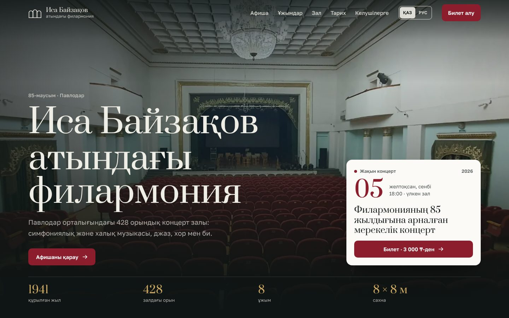
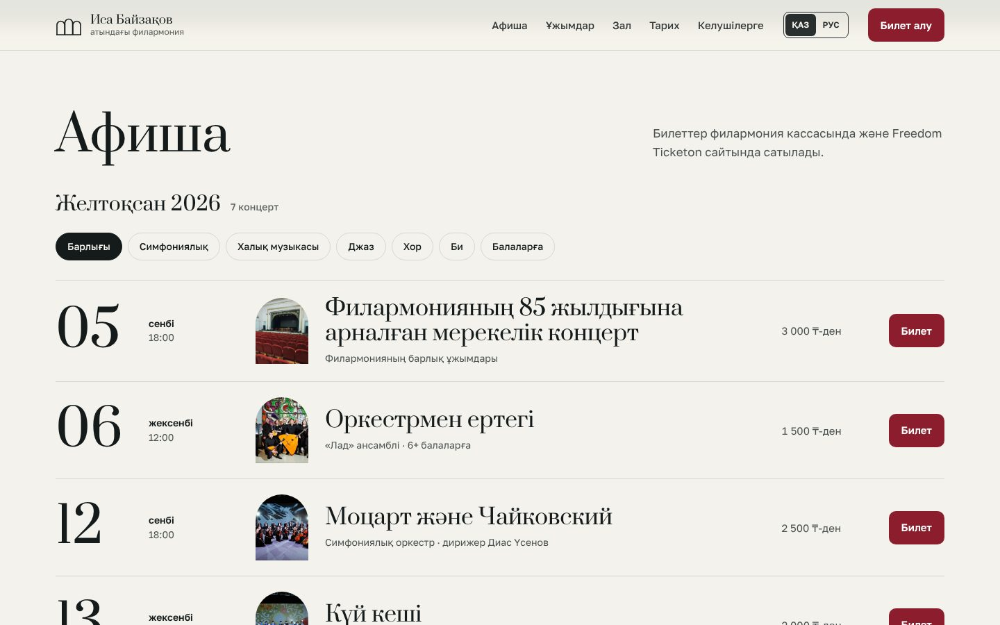
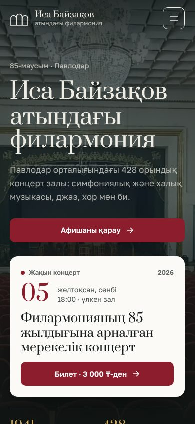

# Филармония имени Исы Байзакова — новый сайт

Дизайн нового сайта Павлодарской областной филармонии имени Исы Байзакова, взамен [isa-philharmonic.kz](https://isa-philharmonic.kz).

Сейчас это **главная страница, свёрстанная в коде**: одна HTML-страница с реальными фото филармонии, переключателем казахский / русский и анимациями GSAP. Это ещё не рабочий сайт: афиша на декабрь 2026 — пример, админки нет.



<p>
  
  
</p>

## Быстрый старт

Нужен только браузер и любой статический сервер:

```bash
cd site
python3 -m http.server 8000
```

Откройте http://localhost:8000. Без Python подойдёт `npx serve -l 8000`.

Открывайте через сервер, а не двойным кликом по файлу: GSAP и шрифты грузятся из интернета (cdnjs, Google Fonts).

## Что на странице

- **Главный экран** — зал с люстрой, ближайший концерт с кнопкой покупки, факты: 1941 год, 428 мест, 8 коллективов, сцена 8 × 8 м.
- **Афиша** — концерты месяца с рабочим фильтром по жанрам, билеты по ссылке на Freedom Ticketon.
- **Коллективы** — восемь коллективов с худруками, на двух языках.
- **Зал** — арка фасада раскрывается на весь экран, дальше фойе, лепнина, люстра и 428 мест.
- **85 лет** — архивные фото и вехи истории с 1941 по 2026 год.
- **Новости и проекты**, **Посетителям** (как купить билет, адрес в 2ГИС, контакты), подвал с обязательными для госучреждения документами.

## Особенности

- **Казахский по умолчанию**, русский по переключателю ҚАЗ · РУС; выбор запоминается.
- **Цвета взяты из самого здания**: лепнина, сцена, бордовые кресла, охра фасада, позолота, мятные панели фойе.
- **Фирменный приём** — арка фасада: в логотипе, рамках фото, миниатюрах афиши.
- **Шрифты** Prata и Golos Text, обе поддерживают Ә Ғ Қ Ң Ө Ұ Ү Һ І.
- **Анимации** GSAP 3 + ScrollTrigger: параллакс, раскрытие арки, горизонтальная лента истории.
- **Доступность**: при `prefers-reduced-motion` движение отключается, без GSAP страница остаётся целой и читаемой, контраст текста ≥ 4,5:1.
- **Адаптивность**: проверено на 1440 и 390 px, на телефоне меню на весь экран и нижняя панель «Билет алу».

## Структура

| Путь | Что это |
|---|---|
| `site/index.html` | Весь дизайн: разметка, CSS и JS в одном файле |
| `site/img/` | 21 фото филармонии в WebP |
| `docs/project-notes.md` | Подробные заметки: решения заказчика, анализ старого сайта, дизайн, что сделать до запуска |
| `docs/plan/` | Анализ старого сайта, план лендинга и каркас (открывается в браузере) |
| `docs/photo-sources.md` | Откуда взято каждое фото |
| `docs/screenshots/` | Снимки для этого README |
| `tools/screenshots.mjs` | Снимки страницы в 9 точках прокрутки на 1440 и 390 px |
| `scripts/install-skills.sh` | Установка скиллов Claude Code, с которыми делался проект |
| `CLAUDE.md` | Правила для Claude Code, если продолжать работу с ним |

## Скриншоты для проверки

```bash
npm i -D playwright
```

```bash
npx playwright install chromium
```

```bash
node tools/screenshots.mjs
```

Снимки появятся в `shots/`, скрипт также сообщит, есть ли горизонтальная прокрутка.

## Статус

Готов дизайн главной страницы. До запуска нужно:

- [ ] получить у филармонии реальную афишу (сейчас концерты, даты и цены выдуманы, коллективы настоящие);
- [ ] проверить ссылку на Freedom Ticketon;
- [ ] отдать казахский текст на вычитку носителю языка;
- [ ] получить оригиналы фото и логотип в векторе;
- [ ] заменить ссылки-заглушки на реальные страницы.

Полный список и план рабочего сайта (Astro, афиша в файле данных, маршруты `/kk/` и `/ru/`) — в [docs/project-notes.md](docs/project-notes.md).

## Права

Фото, тексты и названия принадлежат Павлодарской областной филармонии имени Исы Байзакова и взяты с её сайта. Скиллы Claude Code принадлежат их авторам, лицензии в их репозиториях.
